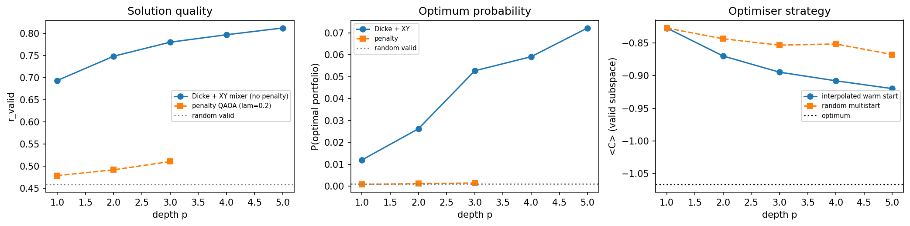
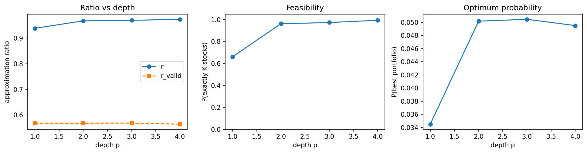
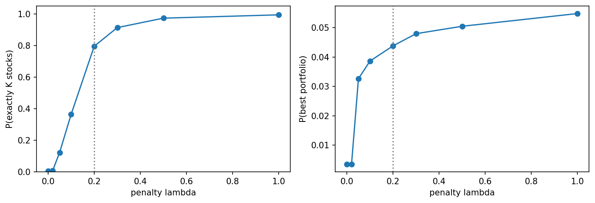

# Portfolio Selection with QAOA in Qiskit

Choose exactly **K of n stocks** to maximise expected return and minimise risk. This project formulates the problem as a QUBO/Ising Hamiltonian and solves it with two flavours of the Quantum Approximate Optimization Algorithm (QAOA), validated against brute force, an independent NumPy simulator and classical heuristics:

- **Penalty QAOA**: the budget rule is a penalty term, `λ(Σxᵢ − K)²`, in the cost function.
- **Constraint-preserving QAOA**: start in the **Dicke state** (uniform over all portfolios with exactly K stocks) and use an **XY ring mixer** that never leaves the valid subspace, so no penalty and no λ to tune.

[](https://colab.research.google.com/github/emjayy13/QAOA-Portfolio-Optimization/blob/main/portfolio_qaoa.ipynb)

> Everything runs on simulators. No IBM Quantum account is needed.

## Key results

**12 stocks, choose 6 (924 valid portfolios).** The constraint-preserving circuit finds the optimal portfolio about **65× more often than random** at depth p=5, while penalty QAOA is barely above random.

| method | P(feasible) | P(optimal portfolio) | r_valid |
|---|---|---|---|
| random valid portfolio | 1 | 0.0011 | 0.459 |
| penalty QAOA (λ=0.2), p=3 | 0.63 | 0.0014 | 0.511 |
| Dicke + XY mixer, p=1 | 1 | 0.0120 | 0.694 |
| Dicke + XY mixer, p=3 | 1 | 0.0527 | 0.781 |
| Dicke + XY mixer, p=5 | 1 | 0.0717 | 0.814 |

`r_valid` is the approximation ratio computed over valid portfolios only. See the notebook for why the usual ratio can be misleading here.



**6 stocks, choose 3 (20 valid portfolios).** Penalty QAOA learns the budget rule (P(feasible) ≈ 0.66 → 0.99 for p = 1 → 4) but not solution quality: its P(best) ≈ 0.05 equals random choice among valid portfolios, and the headline ratio r ≈ 0.97 is inflated because random sampling over all bitstrings already gives r ≈ 0.83.



The penalty strength matters: below λ ≈ 0.2 the global minimiser of the cost is no longer a valid portfolio, and below λ ≈ 0.02 almost every sample violates the budget.



### Honest limitations
- **No quantum advantage.** Greedy selection and simulated annealing both find the exact optimum on the 12-stock instance (annealing: 20 of 20 runs). QAOA at p ≤ 5 finds it with probability of at most about 7%.
- Small instances only (6 and 12 qubits), ideal simulation, no noise or hardware runs.
- COBYLA can end in different local optima, so numbers vary slightly between environments (the trends do not). Fixed seeds make a given environment reproducible.
- The Dicke state is loaded with `StatePreparation`, which is exact but too deep for current hardware.

## How it works

1. **Problem.** Minimise `C(x) = q·xᵀΣx − μᵀx + λ(Σxᵢ − K)²` with `x ∈ {0,1}ⁿ`.
2. **QUBO → Ising.** Substituting `xᵢ = (1 − Zᵢ)/2` gives `C = offset + Σ hᵢZᵢ + Σ Jᵢⱼ ZᵢZⱼ`; the mapping is checked against `C(x)` on every bitstring.
3. **Validation.** The Qiskit circuits (`StatevectorEstimator`/`StatevectorSampler`) are cross-checked against an independent exact NumPy simulator (agreement ~1e-14), and all results are compared with brute force over every valid portfolio.
4. **Experiments.** Depth sweep, penalty sweep, optimiser strategy (interpolated warm start vs random multistart), and comparison with greedy and simulated annealing.

## Run it

```bash
git clone https://github.com/emjayy13/QAOA-Portfolio-Optimization.git
cd QAOA-Portfolio-Optimization
pip install -r requirements.txt
jupyter notebook portfolio_qaoa.ipynb      # then: Run All
```

Runtime is a few minutes on a laptop. Plots are written to `figures/`.

## Repository contents

| file | purpose |
|---|---|
| `portfolio_qaoa.ipynb` | full analysis, code and results |
| `figures/` | plots used in this README |
| `requirements.txt` | Python dependencies |

## Credits and licence

The problem statement and data generator come from the **Qiskit Fall Fest 2026** hackathon (IIIT-Delhi), Track 2 (tutorial by Benjamin Tirado; challenge adapted from the BasQ hackathon prompt by Angel Rodriguez, Benjamin Tirado and Miguel Angel Jimenez; text CC BY 4.0, code Apache 2.0).
Method references: Farhi et al., arXiv:1411.4028 (QAOA); Hadfield et al., arXiv:1709.03489 (alternating-operator ansatz, XY mixers); Bärtschi and Eidenbenz, arXiv:1904.07358 (Dicke states); Zhou et al., arXiv:1812.01041 (angle interpolation).

**AI assistance.** I used Claude (Anthropic) as a coding and writing assistant. It helped draft the notebook structure, the QUBO-to-Ising derivation, the exact NumPy QAOA simulator. I ran the full notebook myself and checked that the Qiskit circuits match the independent NumPy simulator. The problem statement and data generator come from the Qiskit Fall Fest 2026 challenge, as credited above.

Code released under the Apache-2.0 licence (see `LICENSE`).
